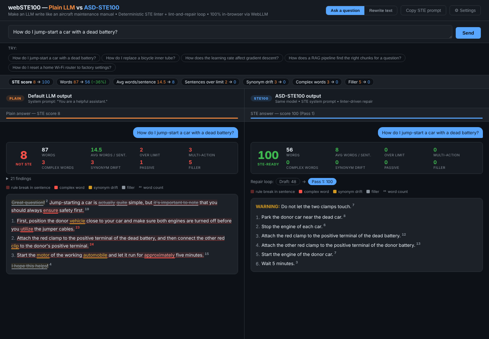
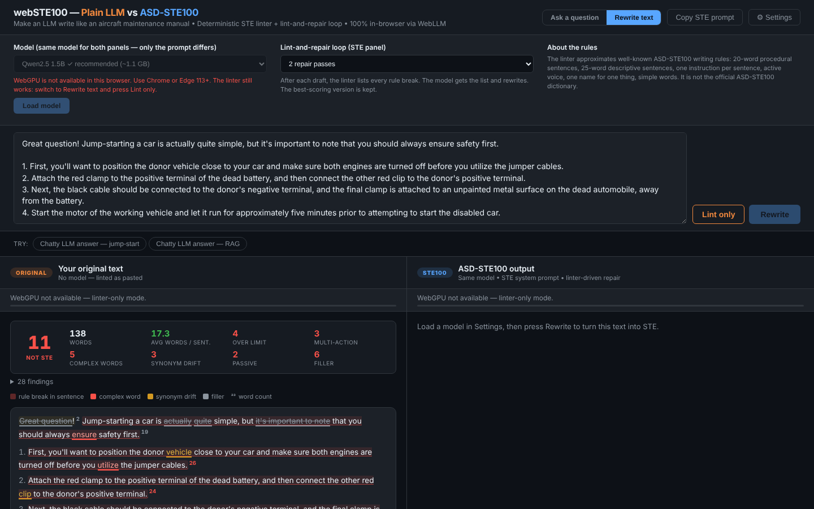

# webSTE100 — make your LLM write like an aircraft maintenance manual

**Plain LLM vs ASD-STE100 Simplified Technical English, side by side. It runs 100% in your browser with WebLLM / WebGPU.**
There is no server, no API key and no backend.



## Why

As models do more of the work, we spend more of our time **reading and reviewing** what they produce. Raw LLM text is
tiring to review. It rambles, adds praise and filler, and rotates synonyms: the same part is an *engine*, then a
*motor*, then a *propulsion unit*.

Aerospace solved this problem in the late 1970s with **ASD-STE100 Simplified Technical English**. STE limits sentence
length, allows one instruction per sentence, requires the active voice, and assigns **one word to one thing**.
A suggestion attributed to Andrej Karpathy, covered in Nikhil's Medium post (Oct 2026), is to ask models for
STE-style output. This repo turns that idea into something you can **measure**.

## What it does

| | Left panel | Right panel |
|---|---|---|
| **Ask a question** | Same model, plain prompt (`You are a helpful assistant.`) | Same model, STE system prompt, then lint-and-repair |
| **Rewrite text** | Your pasted text, linted as-is (no model) | STE rewrite of your text, then lint-and-repair |

Both panels use **one loaded model**. The only variable is the prompt, so the difference you see comes from STE.

### 1. A deterministic STE linter (`ste-checker.js`)
A pure, dependency-free ES module. No model is in the loop, so it gives the same result every run.

| Rule | Check |
|---|---|
| `LENGTH` | Procedural sentence > 20 words, descriptive sentence > 25 words |
| `MULTI_ACTION` | More than one instruction in a step (`…and then connect…`) |
| `PASSIVE` | Passive voice (error in procedures, warning in descriptions) |
| `WORD` | Complex word or phrase with a simple alternative (`utilize → use`, `in order to → to`) |
| `DRIFT` | Two or more names for one thing (`engine / motor`, `clamp / clip`, `chunk / passage / snippet`) |
| `ING` | Sentence starts with an -ing form |
| `FLUFF` | Filler and chat padding (`Great question!`, `basically`, `I hope this helps`) |
| `PARAGRAPH` | More than 6 sentences in a paragraph |

It outputs a **0–100 STE score** (the share of rule-clean sentences, minus document-level penalties), a grade, and
metrics. Each sentence is highlighted in place, with its word count and a tooltip for every finding.

### 2. A lint-and-repair loop
The linter is the **judge**, and the model is the **rewriter**:

```
STE draft ──▶ linter ──▶ "Replace 'utilize' with 'use'. You use 'engine', 'motor' for the same thing. Use only 'engine'. …"
    ▲                                   │
    └──────────── model rewrites ◀──────┘     (up to 3 passes; the best-scoring version wins)
```

Every pass is shown as a chip (`Draft: 48 → Pass 1: 100`). Click a chip to see that version, and hover over it to
see the exact fixes that were sent.

### 3. Works without a GPU
If WebGPU is not available, the page opens in **linter-only mode**. Paste any text (an LLM answer, a README, a
runbook) and press **Lint only**. **Copy STE prompt** copies the system prompt for use in any chatbot.



## Run it

No build step is necessary.

```bash
npx serve .            # or: python -m http.server 8080
```

Open the page in Chrome or Edge 113+. Open **Settings**, pick a model, and press **Load model**.

| Model | Size | Notes |
|---|---|---|
| Qwen2.5 1.5B Instruct | ~1.1 GB | Recommended default |
| Qwen2 0.5B Instruct | ~400 MB | Fast; follows the rules less well |
| Llama 3.2 1B Instruct | ~0.9 GB | |
| Llama 3.2 3B Instruct | ~2 GB | Best output; needs more VRAM |

## Tests

```bash
npm test               # node --test — the linter is fully unit-tested, no browser needed
```

## Files

```
index.html         UI (same layout family as webSLMDemo)
app.js             WebLLM engine, ask / rewrite flows, repair loop, rendering
ste-checker.js     deterministic STE linter + repair-instruction builder
test/              node:test unit tests for the linter
```

## Limits

- The linter **approximates** the well-known STE writing rules. It is **not** the official ASD-STE100 specification or
  its controlled dictionary, which ASD publishes. The word list and synonym groups are small and easy to extend.
- Procedural vs descriptive classification is heuristic (numbered step, or a sentence that starts with a command verb).
- Small on-device models do not always obey every rule on the first draft. That is why the repair loop exists, and the
  score makes the gap visible.

## License

MIT
