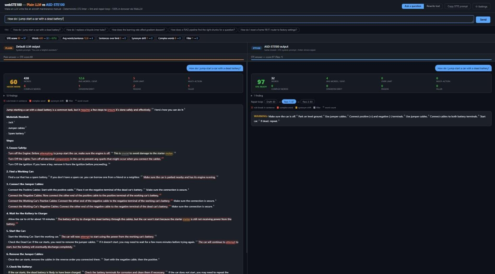
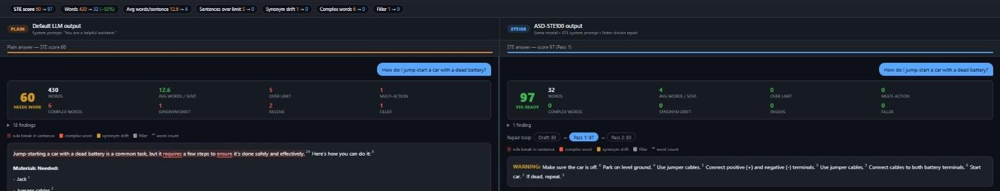
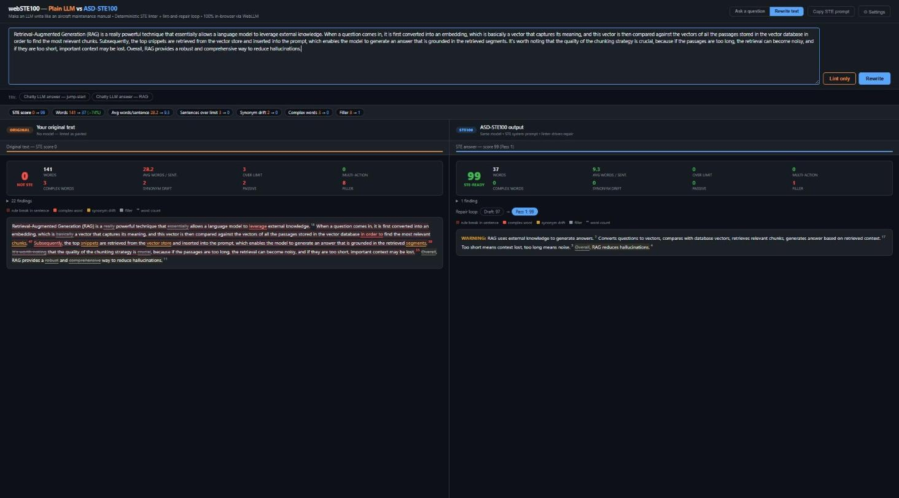
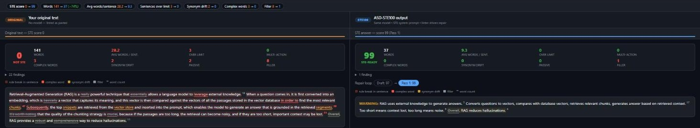

# I made a 1.5B model write like an aircraft maintenance manual — in the browser. Then I made it prove it.

**Live demo:** https://vishalmysore.github.io/webSTE100/
**Code:** https://github.com/vishalmysore/webSTE100


*A live run on my own GPU in Chrome. The model is Qwen2.5-1.5B, run through WebLLM. There is no server and no API key.*

---

## The idea

A suggestion attributed to Andrej Karpathy has been going around this month, covered in
Nikhil's Medium post (Oct 3, 2026). The premise is simple. As models do more of the work, our job moves to
**reading and reviewing** what they produce, and raw LLM text is tiring to review.

The fix he points to is from 1970s aerospace: **ASD-STE100 Simplified Technical English**. It is the controlled
language used to write aircraft maintenance manuals, and its core rules are short:

- Keep a procedural sentence to **20 words** or fewer, and a descriptive sentence to 25 or fewer.
- Write **one instruction** per sentence.
- Use the **active voice**.
- Use **one name for one thing**. If it is a bolt, it stays a bolt. It never becomes a fastener or a screw.

Adding "write in the spirit of ASD-STE100" to a prompt is easy. Knowing whether the model actually did it is harder.
So I built a small tool that **measures** STE compliance, and I put it in the browser next to a plain answer.

## What I built

**webSTE100** is a single static page with no build step. One on-device model is loaded with
[WebLLM](https://github.com/mlc-ai/web-llm) and answers the same input twice.

| Left panel | Right panel |
|---|---|
| The model with a plain system prompt: `You are a helpful assistant.` | The **same model** with an STE system prompt, followed by a lint-and-repair loop |

Both panels use the same model, so the only variable is the prompt.

It has three parts.

### 1. A deterministic STE linter

`ste-checker.js` is about 300 lines of plain JavaScript. It has no model and no dependencies, so it gives the
same result every run.

| Rule | What it flags |
|---|---|
| `LENGTH` | Procedural sentence over 20 words, descriptive sentence over 25 words |
| `MULTI_ACTION` | Two instructions in one step (`…and then connect…`) |
| `PASSIVE` | Passive voice. It is an error in procedures and a warning elsewhere |
| `WORD` | A complex word with a simple alternative: `utilize → use`, `in order to → to`, `prior to → before` |
| `DRIFT` | Two or more names for one thing: `engine / motor`, `clamp / clip`, `chunk / passage / snippet` |
| `FLUFF` | Filler such as `Great question!`, `basically`, `it's worth noting` and `I hope this helps` |
| `ING`, `PARAGRAPH` | Sentences that start with an -ing form, and paragraphs with more than 6 sentences |

It produces a 0–100 score, which is the share of rule-clean sentences minus document-level penalties. It also
annotates every sentence in place, with its word count and a tooltip for each rule it breaks.

### 2. A lint-and-repair loop

The linter is the **judge**. The model is only the **rewriter**.

```
STE draft ──▶ linter ──▶ "Replace 'leverage' with 'use'.
    ▲                     You use 'chunk', 'passage', 'snippet' for the same thing. Use only 'chunk'.
    │                     The sentence 'When a question comes in…' has 47 words. Split it."
    └──── model rewrites ◀──┘        up to 3 passes; the best-scoring version wins
```

Each pass appears as a chip, such as `Draft: 83 → Pass 1: 97 → Pass 2: 83`. Click a chip to see that version.
Hover over it to see the exact fixes that were sent to the model.

### 3. A version that needs no GPU

If WebGPU is not available, the page opens in linter-only mode, where you paste any text and score it. The
**Copy STE prompt** button copies the system prompt so you can use it in any chatbot.

---

## Test 1 — "How do I jump-start a car with a dead battery?"

This was a live run on the deployed site, using Qwen2.5-1.5B-Instruct (q4f16) in Chrome with 2 repair passes.



| | Plain prompt | STE prompt + repair |
|---|---|---|
| STE score | 60 | **97** |
| Words | 430 | **32** |
| Avg words / sentence | 12.6 | 4 |
| Sentences over limit | 5 | 0 |
| Complex words | 6 | 0 |
| Synonym drift | 1 (`engine` / `motor`) | 0 |
| Repair loop | — | Draft 83 → **Pass 1: 97** → Pass 2: 83 |

**What went well.** The linter caught the problems that matter for a reviewer: `ensure`, `attempting` and
`components`, the engine/motor drift, and five sentences over the limit. The plain answer is 430 words long, and
reading it takes real effort.

**What the numbers hide.** These are the things I would not have seen if I had only looked at the score:

1. **The plain answer is wrong in places.** It lists a *jack* and a *spare battery* as "materials needed". It
   also puts a step titled "Connect the Negative Cables" above a sentence about the *positive* cable. STE
   formatting would not fix that. A clear wrong instruction is still a wrong instruction.
2. **The STE answer lost steps.** At 32 words it says "Connect cables to both battery terminals". It does not say
   which cable goes to which terminal, or in what order. That is the most important safety detail in the whole
   procedure.
3. **The repair loop can regress.** Pass 2 scored 83, lower than Pass 1. Keeping the best-scoring version made
   that harmless, but you should not assume that more passes give a better result.

> **Lesson 1: STE compliance is not completeness, and it is not correctness.** The score measures *how* the text
> is written. It does not measure whether the content is right or complete. A 1.5B model found the easiest way to
> score well: say less.

---

## Test 2 — Rewrite a chatty RAG explanation

Rewrite mode keeps the facts fixed. You paste a text, and the model only changes how it is written. I used a
deliberately padded paragraph about RAG.



| | Original | STE rewrite |
|---|---|---|
| STE score | **0** | **99** |
| Words | 141 | 37 |
| Avg words / sentence | 28.2 | 9.3 |
| Sentences over limit | 3 | 0 |
| Synonym drift | 2 (`chunk/passage/snippet/segment`, `vector database/vector store`) | 0 |
| Complex words | 3 (`leverage`, `in order to`, `Subsequently`) | 0 |
| Filler | 8 | 1 |



The annotation view is the most useful part of the tool for a reviewer. You can see every rule break in place:
four names for one thing, a 47-word sentence, and eight filler words.

Then I read the "99" rewrite carefully:

> WARNING: RAG uses external knowledge to generate answers. Converts questions to vectors, compares with database
> vectors, retrieves relevant chunks, generates answer based on retrieved context. Too short means context lost,
> too long means noise. Overall, RAG reduces hallucinations.

It is short, and it uses one term for each thing. But it is not good STE:

- **It drops articles and subjects.** "Converts questions to vectors" has no subject. Real STE requires articles
  and complete sentences. My linter does not check this yet.
- **It packs four actions into one sentence.** My `MULTI_ACTION` rule only looks at imperative sentences, so it
  missed this descriptive one.
- **It misuses `WARNING:`.** In STE a warning is a safety label. Here the model used it as a decoration.
- **It kept `Overall`.** The linter flagged it, but the penalty for one filler word is too small to move the score.

> **Lesson 2: a deterministic judge is only as good as its rules — and the model will find the gaps.** Each gap
> above is now an issue to fix, and each fix is a few lines of code. Fixing a weak judge is cheap. Missing that
> the judge is weak is not.

---

## What I take away

1. **STE as a prompt instruction works.** Even a 1.5B model on a laptop GPU cuts sentence length by two thirds
   and drops the filler and the synonym rotation. For a human reviewer, that is a real improvement.
2. **Make the judge deterministic and visible.** An LLM-as-judge gives you an opinion. The linter lists exact rule breaks, shows them in place, and gives the same result every run.
3. **Measure what you actually care about.** Style compliance is one axis. Completeness and correctness are
   separate axes, and a small model will trade them away to improve the score you give it.

## Next steps for the repo

- Add an **article/subject check** to catch telegraphic sentences like "Converts questions to vectors".
- Extend **multi-action detection** to descriptive sentences.
- Add a **fact-coverage check** for Rewrite mode that compares the key terms of the source with the rewrite.
- Give the repair loop a **length floor**, so that "say less" is no longer the cheapest way to score well.
- Compare the same tasks on Llama 3.2 3B.

## Try it

- **Live:** https://vishalmysore.github.io/webSTE100/ (Chrome or Edge with WebGPU; the first model load is about 1 GB)
- **No GPU?** Switch to *Rewrite text*, paste any LLM answer, and press **Lint only**.
- **In your own chatbot:** press **Copy STE prompt**.

---

*Test setup: Qwen2.5-1.5B-Instruct-q4f16_1-MLC, WebLLM 0.2.79, Chrome with WebGPU, 2 repair passes, temperature
0.5 (plain) / 0.4 (STE draft) / 0.3 (repair). The results are from single live runs; sampling means your numbers
will differ. The linter approximates the well-known ASD-STE100 writing rules. It is not the official ASD-STE100
specification or dictionary.*
